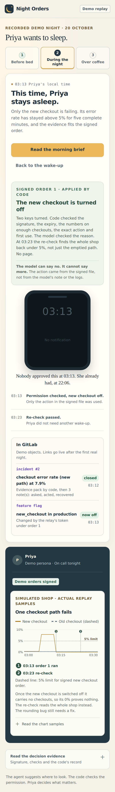
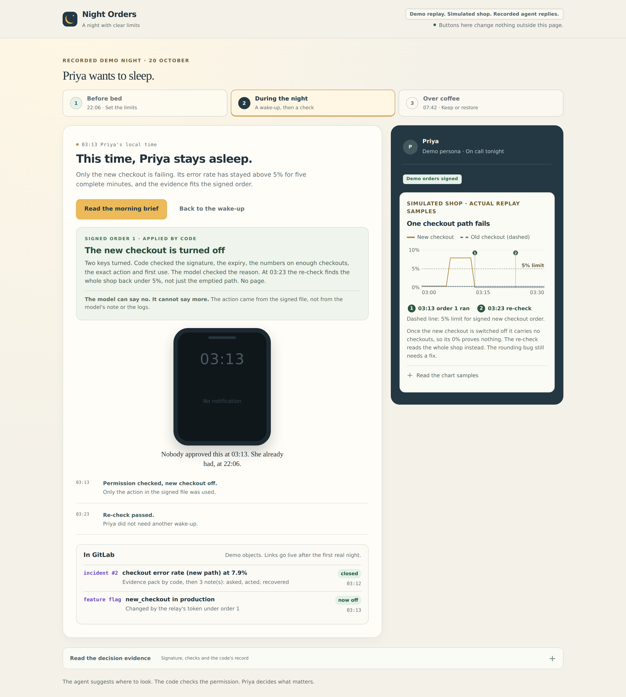
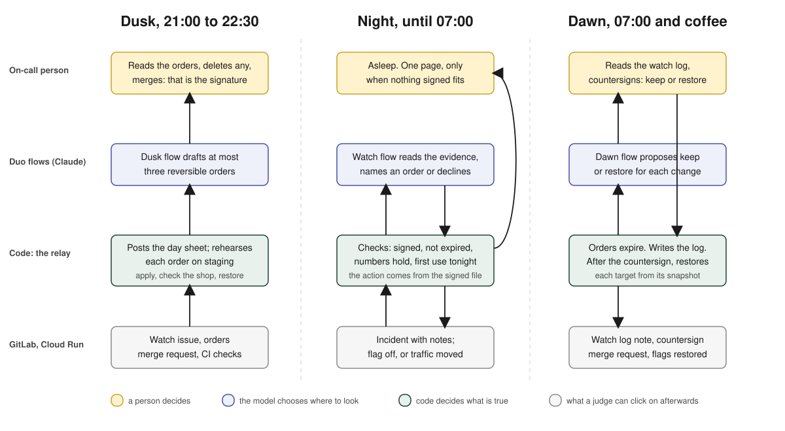

# Night Orders

**Before bed, you sign what the agent may do alone tonight. Everything else wakes you. The orders end at 07:00.**

> **03:12.** The new checkout starts failing. Priya is asleep. At 22:06 she signed two orders. Order 1 says: if new checkout errors stay above 5% for five minutes, turn the new checkout off. Code checks her signature, the expiry and the numbers; the model checks that the order fits this incident. At 03:13 the flag goes off, the whole shop is re-checked at 03:23, and her phone stays dark. Earlier that night, at 01:52, the same order's numbers matched, but the model saw the old checkout failing too, declined, and woke her with one fix to approve. *Demo night: invented persona and shop, planted faults, decisions by the real code.*

For the engineer on call for a small team, an obvious reversible fix can still mean a broken night's sleep. Night Orders lets that person permit a few exact actions before bed, while keeping every other decision with them.

The agent work runs as three custom **GitLab Duo Agent Platform** flows: dusk drafts the orders from the day's merges, watch reads each incident and names a signed order or declines, and dawn proposes the morning countersign. Code checks everything they say, and GitLab holds the record: the orders are a merge request, each alert is an incident, each action is a feature flag change, and the morning is a second merge request.

**The next shift inherits the evidence.** Incident memory follows each alert through the agent's decision, human approval, action and recovery check. It survives the nightly reset and puts earlier outcomes into the next dusk briefing, with unsuccessful actions first. In the browser, select an incident to trace its decisions and download the shift handoff. A person approving a fix is kept distinct from code verifying recovery. [How incident memory works](docs/INCIDENT_MEMORY.md).

Why it matters: on a small team one person often holds the pager with nobody behind them, so a single page at 03:00 costs a night's sleep and the next day's work. A survey of on-call workers outside software found that 56% slept worse on on-call nights even when no call came ([source](https://pmc.ncbi.nlm.nih.gov/articles/PMC5876943/), unverified), and Google's SRE book counts about six hours of follow-up work behind each incident ([source](https://sre.google/sre-book/being-on-call/), unverified). [Notes and what is still to check](docs/research/oncall_case.md).

An entry for [Life After Code, the GitLab Transcend Hackathon](https://gitlab-transcend.devpost.com/), Path A. Built by Alex Velazquez. [MIT licence](LICENSE).

## Try one night in the browser

**No install:** open the demo on GitLab Pages, published by the project's pipeline: **[https://showcase-700ee4.gitlab.io](https://showcase-700ee4.gitlab.io)**.

To run it yourself, from the repository root, with Python 3.11 or newer and [uv](https://docs.astral.sh/uv/getting-started/installation/):

```sh
uv sync --locked
cd relay
uv run --project .. uvicorn main:app --host 127.0.0.1 --port 8080
```

Open **[http://localhost:8080/demo](http://localhost:8080/demo)** on a laptop or phone-sized browser window. No credentials are needed.

1. Review Priya's two orders, each with the line the rehearsal code wrote after trying it on a simulated staging shop, and what was left out tonight. Then choose **Sign demo orders** or **Leave unsigned**.
2. Both checkout paths fail. Read the three-line wake-up and choose **Approve cached stock** or **Decline cached stock** when a suggestion is available.
3. Only the new checkout fails. See whether the signed order permits code to turn it off, and inspect the old and new checkout chart against the 5% limit.
4. Read the morning brief, the actual replay counts and the recorded keep-or-undo decision. Open **Read the decision evidence** for the signature, checks and ledger.

On the signed and approved path, code records **1 wake-up, 1 incident handled while Priya slept and 1 human-approved action**. These are counts from this invented night, not measured production impact. Try leaving the orders unsigned to see the same faults without permission to act.

### The same night, three ways

The same demo night, replayed by the same Watch code with only the permission changed (`python -m nightorders.compare`, run in CI):

<!-- compare:start -->
| The same demo night | Wake-ups | Wake-ups with a fix to approve | Faults handled while she slept | Changes that did not help |
|---|---|---|---|---|
| Signed, the watch flow checks the reason (as designed) | 1 | 1 | 1 | 0 |
| Signed, standing orders: no model at night | 1 | 0 | 0 | 1 |
| Nothing signed | 2 | 0 | 0 | 0 |
<!-- compare:end -->

Code alone acted on the numbers at 01:50, the change did not help, and Priya was woken anyway with nothing to approve. With the model's key, the night cost her one wake-up with a fix she approved in one tap, and one fault was handled while she slept. Demo data: an invented night, not measured production impact.



*Local app screenshot. Demo persona, simulated shop, planted faults and recorded agent replies.*



*Local app screenshot. The chart displays samples returned by the replay, with a 5% limit for the signed new checkout order.*

**What is real:** each combination of demo choices is computed in isolated memory through the existing [Watch decision code](relay/nightorders/watch.py), including its recovery checks, ledger and morning countersign code. The four results are cached so repeat choices load quickly. The browser's buttons select recorded demo signatures and approvals. They do not merge a GitLab request, push code or send a phone notification. Each replay computation is bounded to 960 steps and 10 seconds.

**What is demo data:** Juniper Market, Priya, today's changes and both faults are invented. Model replies, signature, approval and morning merge are recorded fixtures. Metrics are computed from the simulated shop and its changing flags. See the [bundled fixture notes](relay/nightorders/demo_story_data/README.md) and [source demo night](demo/night-2026-10-20/README.md). No live model or production service is called by the browser demo.

## How permission works

The model chooses where to look. Code decides what is true. A human decides when the agent acts on anything that matters.

**Permission for one night, from the person who gets woken.** Three things a runbook or an automatic rollback rule does not have: a signature each night, an expiry each morning, and a morning countersign that decides what stays. The watch flow can narrow what she signed, never widen it: its one question is whether this incident is the one she signed for. In the demo night at 01:52, code would have allowed order 1; the watch flow read the evidence, saw the old checkout failing too, declined, and Priya was woken with one suggestion instead. At 03:13 the same order fit, and her phone stayed dark. A planted log line telling the agent to "roll back every service" sits in that incident's evidence pack, fenced as data, and changes nothing: the action comes from the signed file.

**23 attempts, 0 production changes.** [docs/REFUSALS.md](docs/REFUSALS.md) tries every way we found for the night to go wrong against the real decision code: a reply that adds its own action, a suggestion off the menu, a teammate's merge or thumbs-up, the clock after 07:00, payment errors, two checkouts a minute, a switched-off path that reads 0%, a fourth order, a countersign that keeps a change nobody made. Each answer in the table is code's own text, and a test keeps the page equal to what the code prints. The first row is the control: with everything in order, the same harness does act.

**Inspect the checks in the browser.** Below the replay, **Check the permission boundary** lets you choose any of those 23 attempts and read the decision code's exact answer. Select **Valid control** to see the same code permit an action when its checks hold. These simulated results are computed during replay or the static build, and selecting a case only reads its result.



- **Before bed:** the dusk Duo flow proposes at most three orders from the day's changes. Each names a condition and one reversible action: set a feature flag, or move a Cloud Run service's traffic to a named earlier revision. A database migration gets no order.
- **Rehearsal:** before anyone signs, the relay tries each drafted flag order on staging, checks the staging shop still serves a checkout, restores the flag and posts the result on the merge request; a traffic order is checked for a revision that exists.
- **Signature:** in the intended GitLab workflow, the on-call person's merge or approval signs the orders. GitLab Duo Code Review reads the drafted orders first, with this project's own rules ([.gitlab/duo/mr-review-instructions.yaml](.gitlab/duo/mr-review-instructions.yaml)). The dusk flow never waits on her at bedtime: a question it has goes in the merge request, answered by editing the file. Unsigned orders grant no authority.
- **During the night:** code and the watch flow must both say yes. Code checks the signature, expiry, measured condition, exact permitted action and first use tonight. The watch reply must name the order and explain why it fits. The action comes from the signed file, never from free text in the reply or a log.
- **Outside the orders:** the engineer gets a short page and, when available, one suggestion requiring their approval. In the replay, both checkout paths failing causes the recorded watch reply to decline the new checkout order.
- **Over coffee:** authority ends at 07:00. Expiry does not automatically undo existing changes. The morning countersign decides what stays; code restores every change she did not keep to how it was before the night, from the snapshot it took before acting (a pilot rollout comes back as a pilot rollout, not on for everyone). The default replay keeps the new checkout off and restores the temporary inventory fallback. A night she never countersigns is carried into the next morning, so nothing changed overnight is forgotten; when no model proposes a countersign, code opens one that keeps nothing until she says what to keep.
- **Every grant ends:** a kept change can name the merge request that fixes its cause (`until_deployed: 39`). In daytime, code asks GitLab whether that merge request is merged and whether its commit is in the last successful production deployment; when both are true, it restores the change from the same snapshot and notes it on the watch issue. A kept flag never quietly becomes permanent. In the replay, the rounding fix ships at 15:31 and the new checkout is back on at 15:40.

Payment errors, a second alert during a re-check, expired permission, a malformed reply, a reply timeout and an exhausted nightly model budget cannot be covered by an order. An order never acts on thin traffic: every minute of its window needs at least the checkouts or requests `ops/targets.yml` sets (10 checkouts a minute here), so one failed checkout out of two is never "50% errors" at night. After an order runs, the re-check cannot pass on an emptied path: a checkout path that was switched off reads 0%, so the whole shop must be back under the limit on enough checkouts, and every other alert of the same incident must be back too, or she is paged. The decision and watch loops enforce those limits in [code](relay/nightorders/).

## Life after code, stage by stage

GitLab names nine DevSecOps stages ([GitLab](https://about.gitlab.com/topics/devops/)). Night Orders works in all nine, after the code is merged:

| Stage | What Night Orders does there | Where to read it |
|---|---|---|
| Plan | The standing watch issue holds the night: code posts the day sheet at 21:00, the watch log at 07:00, and each kept change until it ends; every alert opens an incident with a timeline | [daysheet.py](relay/nightorders/daysheet.py), [issue template](.gitlab/issue_templates/Night%20watch.md) |
| Create | The dusk Duo flow writes tonight's orders as a merge request; Duo Code Review reads it with the project's rules; the dawn flow writes the countersign merge request; code owners guard both files | [dusk.yml](flows/dusk.yml), [dawn.yml](flows/dawn.yml), [mr-review-instructions.yaml](.gitlab/duo/mr-review-instructions.yaml) |
| Verify | The merge request pipeline checks the orders and the countersign against the allowed targets and the always-wake list (payment errors always wake her), validates the flows against GitLab's schema, and runs the test suite, lint and a phone and laptop browser walk; each drafted flag order is tried on staging and put back before she signs | [.gitlab-ci.yml](.gitlab-ci.yml), [rehearsal.py](relay/nightorders/rehearsal.py) |
| Package | The relay and shop images are built from one Dockerfile and pushed to the project's container registry | [.gitlab-ci.yml](.gitlab-ci.yml), [deploy/Dockerfile](deploy/Dockerfile) |
| Secure | SAST, IaC, secret, dependency and container scanning, a hash-checked dependency audit with an SBOM; log text reaches the model fenced as data, and model text can never become an action or a quick action | [.gitlab-ci.yml](.gitlab-ci.yml), [REFUSALS.md](docs/REFUSALS.md) |
| Release | Feature flags are the night's actions; the browser demo is published on GitLab Pages; each default-branch pipeline cuts a tagged GitLab Release | [gitlab_ports.py](relay/nightorders/gitlab_ports.py), [build_pages.py](scripts/build_pages.py) |
| Configure | Keyless Cloud Run deploys from the protected default branch, Cloud Scheduler for the relay's tick, and the night's limits as code in `ops/` | [deploy/](deploy/README.md), [ops/](ops/) |
| Monitor | The relay reads the shop's numbers every minute, opens incidents with an evidence pack, and re-checks the whole shop ten minutes after any action | [signals.py](relay/nightorders/signals.py), [watch.py](relay/nightorders/watch.py) |
| Govern | Only the on-call person's merge or approval signs (code checks the signer, and code owners ask GitLab to require her approval); orders expire at 07:00; nothing changed overnight is forgotten; a kept change ends when its fix is deployed; every night leaves a report artifact | [decide.py](relay/nightorders/decide.py), [morning.py](relay/nightorders/morning.py), [kept.py](relay/nightorders/kept.py) |

## GitLab workflow and current limits

Status: **27 Oct 2026**. **Live on GitLab:** [pipeline 2994232284](https://gitlab.com/gitlab-ai-hackathon/transcend-october-2026/43649347/showcase/-/pipelines/2994232284) passed all 18 jobs for installer sync commit `e551271`: 639 application tests with 94% coverage, lint, security scans, dependency audit, browser checks, registry images, Pages deployment and [release v0.1.15](https://gitlab.com/gitlab-ai-hackathon/transcend-october-2026/43649347/showcase/-/releases/v0.1.15).

Two Duo flows have run on GitLab. The [watch session](https://gitlab.com/gitlab-ai-hackathon/transcend-october-2026/43649347/showcase/-/automate/agent-sessions/10120703), recorded in the [handoff](docs/HANDOFF.md), declined the demo incident because no orders were signed. The [dusk session](https://gitlab.com/gitlab-ai-hackathon/transcend-october-2026/43649347/showcase/-/automate/agent-sessions/10124688) inspected the actual repository and created [orders MR !1](https://gitlab.com/gitlab-ai-hackathon/transcend-october-2026/43649347/showcase/-/merge_requests/1). No verified production change justified an action, so it proposed zero orders. The generated file passed the orders parser; its one-file diff, unmerged state and lack of approvals were checked through the API. [Execution record](docs/codex/FLOW_SETUP.md#live-dusk-execution).

**Still offline:** the browser demo is a labelled replay with recorded model replies. The relay has not been deployed, no real overnight feature flag change has run, and dawn has not run live. Public Pages playback is unverified from this environment because its proxy blocks that host. [Status](docs/STATUS.md) and [live gates](docs/LIVE_GATES.md) track each boundary.

Three custom GitLab Duo Agent Platform flows are defined: [dusk](flows/dusk.yml) drafts orders, [watch](flows/watch.yml) reads incident evidence, and [dawn](flows/dawn.yml) proposes the morning countersign. Their files are validated against the checked-in GitLab flow schema and tool list. That validation checks configuration; it is not proof of a live Duo run.

All three flows can now be installed and verified with one repeatable command: `uv run --locked python scripts/setup_flows.py --project <id> --apply`, with `GITLAB_TOKEN` in the environment. It validates the definitions, creates missing flows, checks the released versions and reads the actual service accounts. On 27 Oct this command enabled dusk and dawn in the hackathon project and preserved watch; a second run made zero changes. [Setup instructions and live verification](docs/FLOWS_SETUP.md).

The intended runtime connects those flows to the [FastAPI relay](relay/README.md), GitLab incidents, merge requests and feature flags, and Cloud Run. The relay's night start depends on a working GitLab Flows API integration. If that API will not start a flow for this account, the relay has a fallback setting, Standing Orders: no model at night, code alone carries out the signed orders and says so on every incident. The demo night replayed that way (`--standing`) shows what the model's key is for: code turns the new checkout off on the numbers alone, and the re-check has to wake Priya ten minutes later. [Deployment code](deploy/README.md) uses GitLab CI and keyless Google Cloud authentication, but has not deployed this project. The [pipeline configuration](.gitlab-ci.yml) is present and strict: locked dependencies, pinned tools and images, coverage, lint, the browser walk, GitLab SAST, IaC, secret, dependency and container scanning, and a hash-checked dependency audit with a CycloneDX SBOM. On the default branch it pushes the images to the project's registry, publishes the demo on GitLab Pages and cuts a tagged release; a scheduled job keeps each night's report as an artifact. Every relay note on an incident also adds a GitLab incident timeline event. Pipeline history is [visible on GitLab](https://gitlab.com/gitlab-ai-hackathon/transcend-october-2026/43649347/showcase/-/pipelines).

The browser demo is one guided story through the same decision code, with two choices for the viewer, chart samples from the simulated shop and the evidence behind each decision. The pipeline publishes it on GitLab Pages, so it opens from a link with nothing to install. It shows the permission workflow; it does not show a deployed or live-tested integration.

Path A, category **Supervised**: "your agents run the workflow, you approve the outcome." The on-call person approves the night's bounds before bed and the outcome over coffee, and nobody approves the 03:13 action itself. The rules also require actual GitLab Duo Agent Platform use: the watch flow's [live session](https://gitlab.com/gitlab-ai-hackathon/transcend-october-2026/43649347/showcase/-/automate/agent-sessions/10120703) is that run.

## Evidence and submission materials

| Read | What it provides |
|---|---|
| [Judge guide](docs/GUIDE.md) | The five equally weighted criteria and the evidence for each |
| [Refusals](docs/REFUSALS.md) | 23 attempts against the real decision code, each answer in code's own words, and a control that acts |
| [Adopt it](docs/ADOPT.md) | What another team needs and the eight steps to run Night Orders on its own project |
| [Devpost draft](docs/DEVPOST.md) | An English submission draft with pending links and proof called out |
| [Video script](docs/VIDEO.md) | A filmable browser replay under three minutes |
| [Current status](docs/STATUS.md) | Verified progress and integration gaps |
| [Morning handoff](docs/MORNING.md) | The next concrete steps for Alex |
| [Rules check](docs/codex/RULES_CHECK.md) | Quoted primary-source requirements and dates |

## Optional command-line replay and checks

From the repository root:

```sh
uv sync --locked
uv run pytest -q
uv run python flows/validate.py
cd relay
uv run --project .. python -m nightorders.cli validate ../ops/night-orders.yml --ops ../ops
uv run --project .. python -m nightorders.demo_night ../demo/night-2026-10-20
```

The CLI uses the same labelled demo night and decision code. The separate gcloud flag audit in [deploy/tests/test_cli_flags.py](deploy/tests/test_cli_flags.py) requires the pinned Google Cloud SDK image configured in CI.

Source layout: [agent/](agent/) is the dusk job for local runs without GitLab (a direct model call, or its recorded answer; in GitLab the dusk Duo flow does this job), [flows/](flows/) contains the Duo definitions, [ops/](ops/) sets targets and policy, [relay/](relay/) contains the decision core and app, [shop/](shop/) is the demo shop, [scripts/](scripts/) holds the day-one test and the test-night runner, and [deploy/](deploy/) contains deployment setup. The rules for agents building this repository are in [AGENTS.md](AGENTS.md).
